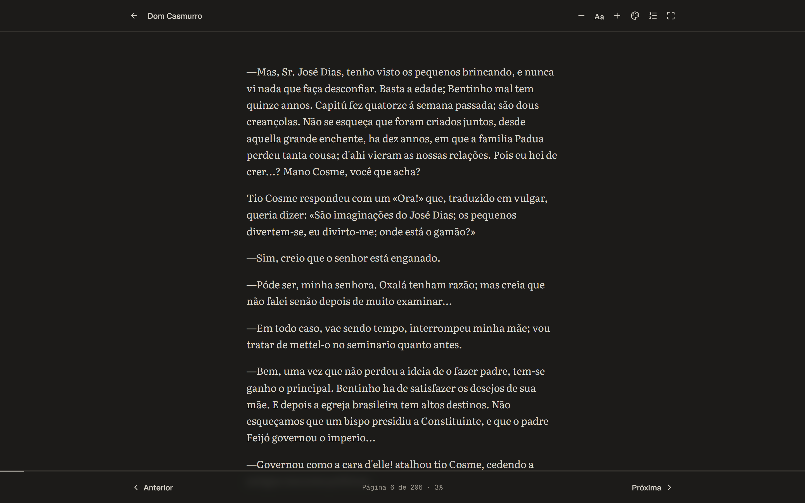
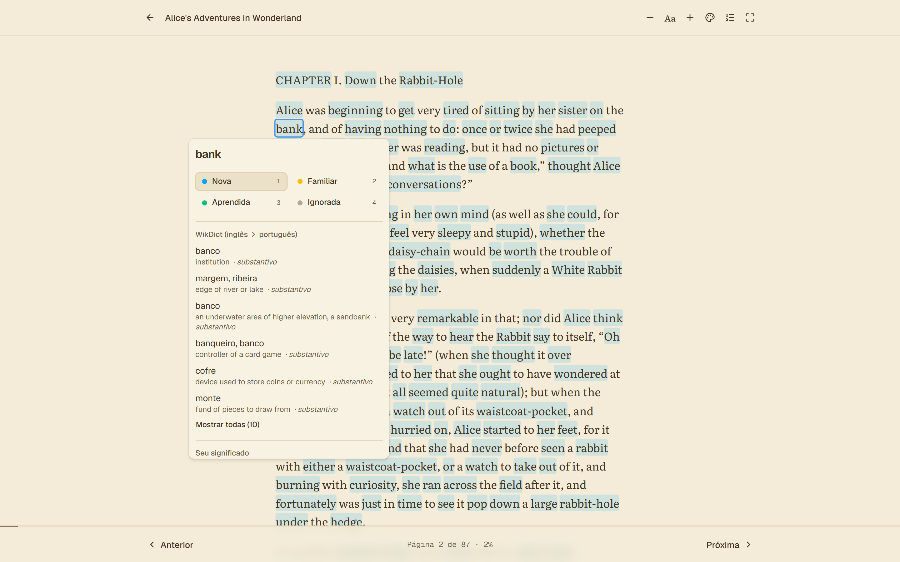
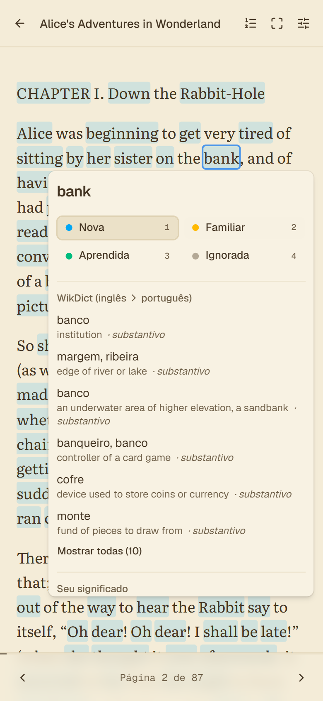
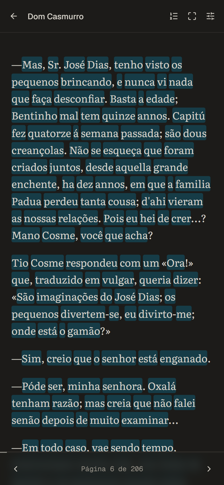

# Leitura

**English** · [Português](README.pt-BR.md)

A web app for reading your own books. Import a PDF or EPUB and read it in a clean,
paginated reader that remembers where you stopped.



<table>
  <tr>
    <td colspan="2">
      
      <p align="center">Click any word to see its meaning (English → Portuguese)</p>
    </td>
  </tr>
  <tr>
    <td align="center" width="50%">
      
      <p>The same on a phone</p>
    </td>
    <td align="center" width="50%">
      
      <p>Night theme</p>
    </td>
  </tr>
</table>

## Features

- **PDF and EPUB import.** The text is extracted in the browser; the file itself is never uploaded or stored.
- **Pages that fit a reading session.** Books are split into pages of about _N_ words (you choose), never cutting a paragraph.
  Before saving you can review the title, author, language and cover, and preview the pages.
- **A reader made for long sessions.** Three themes (Papel, Sépia, Noite), three fonts (Geist, Literata, Atkinson Hyperlegible),
  adjustable text size, full screen and a page index.
- **Progress.** Every book opens where you left off.
- **Library** as a list or a grid of covers, with editing and deleting from the book menu.
- **Accounts** with email and password, including password recovery. Each user only sees their own books.
- Works on phones as well as on desktop.

The interface is in Brazilian Portuguese. Code and comments are in English.

## Stack

React, Vite, TypeScript, Tailwind CSS, shadcn/ui, TanStack Query, i18next and Supabase (auth, Postgres, storage), with Bun as the package manager.

## Getting started

You need [Bun](https://bun.sh) and a [Supabase](https://supabase.com) project (the free plan is enough).

```bash
bun install
bun run dev
```

### Supabase setup

1. **Environment variables.** Copy `.env.example` to `.env.local` and fill in the values from
   _Project Settings → API Keys_ (Project URL and the **publishable** key, `sb_publishable_…`).
   Never put the secret key (`sb_secret_…`) in a `VITE_` variable: those are bundled into the public JavaScript.
2. **Database.** Add `DATABASE_URL` to `.env` (dashboard → _Connect_ → **Session pooler** string;
   the direct `db.<ref>.supabase.co` host needs IPv6). Then apply the migrations:

   ```bash
   bun run db:push
   ```

   Only migrations not yet applied are run; the history is stored in the database.
   New schema changes go in a new file in `supabase/migrations/` (`<timestamp>_<name>.sql`).
3. **Auth.** In _Authentication → Sign In / Providers → Email_:
   - keep **Email** enabled;
   - turn **off** "Confirm email" (users can sign in right after signing up).
4. **Password recovery.** In _Authentication → URL Configuration_, set the Site URL to where the app runs
   and add `<your-url>/reset-password` to the Redirect URLs.

### Data model

- `books`: metadata, cover path, `words_per_page` and totals.
- `pages`: the text, one row per page (about `words_per_page` words, never cutting
  a paragraph), numbered 1..N across the book.
- `reading_progress`: the last page each user read in each book.
- `covers` storage bucket (private): `<user_id>/<book_id>-<timestamp>.webp`.
- `import_book(p_book, p_pages)`: saves a whole book in one transaction.

Every user only sees their own books, covers and progress (Row Level Security).
The files in `supabase/migrations/` are the history of how this schema evolved.

## Project structure

```
src/
  app/          entry, router, route paths, providers (theme)
  pages/        route screens; compose components, no data logic
  components/
    ui/         shadcn/ui components (generated)
    layout/     header, footer, page shell
    auth/       sign in, sign up and password recovery forms
    books/      library list and grid, cover, book form, page index
    reader/     reader view and controls
    import/     file dropzone, extraction progress, review and preview
  services/     all Supabase access (auth, books, pages, progress, covers)
  lib/
    import/     shared entry point for reading book files
    pdf/        PDF text extraction (pdf.js Web Worker) and text cleanup
    epub/       EPUB text extraction (unzip + XHTML)
    pagination/ splits the text into pages of ~N words
    supabase.ts Supabase client
    i18n.ts     translations setup
  hooks/        React hooks
  types/        domain and database types
  locales/      UI translations (pt-BR)
  utils/        small helpers
supabase/
  migrations/   SQL migrations
```

## License

Copyright © 2026 Gabriel Bento

Leitura is free software under the [GNU Affero General Public License v3.0](LICENSE).
You can use, study, change and share it. If you distribute it, or run a modified version
as a service others can use, you must publish your source code under the same license
and keep the original copyright notice.

If you would like to use Leitura under different terms (for example in a closed-source product),
contact the author for a separate license.

Third-party assets are listed in [CREDITS.md](CREDITS.md).
The books in the screenshots are _Dom Casmurro_ by Machado de Assis and _Alice's Adventures in Wonderland_ by Lewis Carroll
(public domain, from Project Gutenberg). Dictionary entries come from [WikDict](https://www.wikdict.com) (CC BY-SA).
