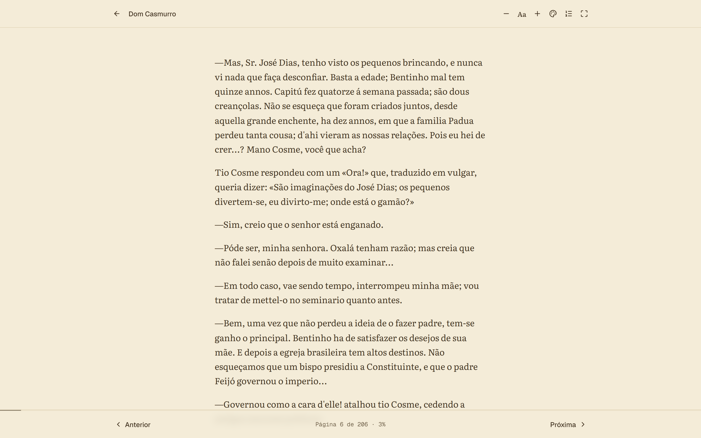

# Leitura

[English](README.md) · **Português**

Um app web para ler os seus próprios livros. Importe um PDF ou EPUB e leia num leitor
limpo e paginado, que lembra onde você parou.



## Funcionalidades

- **Importação de PDF e EPUB.** O texto é extraído no navegador; o arquivo em si nunca é enviado nem guardado.
- **Páginas do tamanho de uma leitura.** O livro é dividido em páginas de cerca de _N_ palavras (você escolhe), sem nunca cortar um parágrafo.
  Antes de salvar, dá para revisar título, autor, idioma e capa, e ver uma prévia das páginas.
- **Um leitor feito para ler por horas.** Três temas (Papel, Sépia, Noite), três fontes (Geist, Literata, Atkinson Hyperlegible),
  tamanho do texto ajustável, tela cheia e índice de páginas.
- **Progresso.** Cada livro abre onde você parou.
- **Biblioteca** em lista ou em grade de capas, com edição e exclusão pelo menu do livro.
- **Contas** com e-mail e senha, incluindo recuperação de senha. Cada pessoa só vê os próprios livros.
- Funciona no celular e no computador.

A interface é em português do Brasil. O código e os comentários são em inglês.

## Tecnologias

React, Vite, TypeScript, Tailwind CSS, shadcn/ui, TanStack Query, i18next e Supabase (autenticação, Postgres, storage), com Bun como gerenciador de pacotes.

## Como rodar

Você precisa do [Bun](https://bun.sh) e de um projeto no [Supabase](https://supabase.com) (o plano gratuito basta).

```bash
bun install
bun run dev
```

### Configuração do Supabase

1. **Variáveis de ambiente.** Copie `.env.example` para `.env.local` e preencha com os valores de
   _Project Settings → API Keys_ (Project URL e a chave **publishable**, `sb_publishable_…`).
   Nunca coloque a chave secreta (`sb_secret_…`) numa variável `VITE_`: elas vão para o JavaScript público.
2. **Banco de dados.** Adicione `DATABASE_URL` ao `.env` (painel → _Connect_ → string do **Session pooler**;
   o host direto `db.<ref>.supabase.co` exige IPv6). Depois aplique as migrations:

   ```bash
   bun run db:push
   ```

   Só rodam as migrations ainda não aplicadas; o histórico fica guardado no banco.
   Mudanças novas no schema vão num arquivo novo em `supabase/migrations/` (`<timestamp>_<nome>.sql`).
3. **Autenticação.** Em _Authentication → Sign In / Providers → Email_:
   - mantenha **Email** ativado;
   - **desative** "Confirm email" (a pessoa entra logo depois de criar a conta).
4. **Recuperação de senha.** Em _Authentication → URL Configuration_, defina o Site URL como o endereço do app
   e adicione `<seu-endereço>/reset-password` às Redirect URLs.

### Modelo de dados

- `books`: metadados, caminho da capa, `words_per_page` e totais.
- `pages`: o texto, uma linha por página (cerca de `words_per_page` palavras, sem cortar
  parágrafos), numeradas de 1 a N no livro todo.
- `reading_progress`: a última página que cada pessoa leu em cada livro.
- bucket `covers` (privado): `<user_id>/<book_id>-<timestamp>.webp`.
- `import_book(p_book, p_pages)`: salva um livro inteiro numa única transação.

Cada pessoa só vê os próprios livros, capas e progresso (Row Level Security).
Os arquivos em `supabase/migrations/` são o histórico de como o schema evoluiu.

## Estrutura do projeto

```
src/
  app/          entrada, rotas, caminhos das rotas, providers (tema)
  pages/        telas das rotas; montam componentes, sem lógica de dados
  components/
    ui/         componentes shadcn/ui (gerados)
    layout/     cabeçalho, rodapé, estrutura da página
    auth/       formulários de entrar, criar conta e recuperar senha
    books/      biblioteca em lista e grade, capa, formulário do livro, índice de páginas
    reader/     leitor e seus controles
    import/     área de arquivo, progresso da extração, revisão e prévia
  services/     todo acesso ao Supabase (auth, livros, páginas, progresso, capas)
  lib/
    import/     ponto de entrada comum para ler arquivos de livro
    pdf/        extração de texto de PDF (Web Worker do pdf.js) e limpeza do texto
    epub/       extração de texto de EPUB (unzip + XHTML)
    pagination/ divide o texto em páginas de ~N palavras
    supabase.ts cliente do Supabase
    i18n.ts     configuração das traduções
  hooks/        hooks React
  types/        tipos do domínio e do banco
  locales/      traduções da interface (pt-BR)
  utils/        funções auxiliares
supabase/
  migrations/   migrations SQL
```

## Licença

Copyright © 2026 Gabriel Bento

O Leitura é software livre sob a [GNU Affero General Public License v3.0](LICENSE).
Você pode usar, estudar, modificar e compartilhar. Se distribuir o app, ou rodar uma versão modificada
como serviço para outras pessoas, precisa publicar o seu código-fonte sob a mesma licença
e manter o aviso de copyright original.

Se quiser usar o Leitura em outros termos (por exemplo, num produto de código fechado),
entre em contato com o autor para uma licença separada.

Os recursos de terceiros estão listados em [CREDITS.md](CREDITS.md).
O livro da captura de tela é _Dom Casmurro_, de Machado de Assis (domínio público, do Project Gutenberg).
