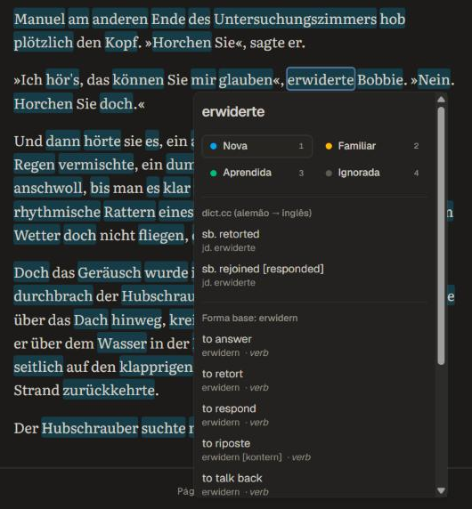
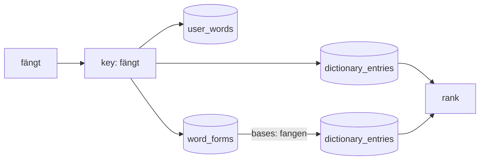

# How a word is looked up

> `dictionary` branch only. German and English books.

The dictionary is the one chosen for the book's language on the **Configurações**
page (stored in `user_dictionaries`):

| Book language | Dictionaries | Default |
|---|---|---|
| German | dict.cc (German → English), WikDict (German → Portuguese) | dict.cc |
| English | WikDict (English → Portuguese) | WikDict |

The examples below use dict.cc; WikDict works the same way, except for the ranking
in step 5.

This explains the "black box": given **one clicked word** (as written on the page),
what comes out of it. The sentence around the word is never used.

*Clicking "erwiderte": its own dict.cc entries ("sb. retorted"), then those of its
base word, **erwidern** ("to answer").*

## Input and output

- **In:** the word exactly as written, e.g. `fängt`, plus the book's language (`de`).
- **Out:**
  1. the user's status and own meaning for that word;
  2. the chosen dictionary's translations of the word itself;
  3. its translations of the **base word**, when it's an inflected form
     (`fängt` → `fangen`, `went` → `go`).

## The steps

### 1. Make a key

The word is turned into a lookup key: Unicode-normalized, curly apostrophes made
straight, lowercase (German rules). `Häusern` → `häusern`.

Lowercase matters because every sentence starts with a capital letter: "Die" and
"die" must be the same word.

### 2. Status and meaning

`user_words` is read by `(user, language, key)`. Nothing there means the word is
**Nova**. Since the key is the clicked form, `ist` and `bist` have separate statuses.

### 3. The word's own translations

`dictionary_entries` is read by `(chosen dictionary, key)`. One row holds every
sense whose headword, once cleaned, equals the key. For dict.cc, cleaning removes
gender `{n}`, notes `[ugs.]`, `<abbr.>`, `(optional parts)` and placeholders
(`etw.`, `jdm.`, `sich`, also joined: `jdn./etw.`), so `(jdm.) etw. [Akk.] sagen`
is found under `sagen` and `jdn./etw. fangen` under `fangen`.

### 4. The base word

`word_forms` is read by `(language, key)` and gives the base word(s):
`fängt` → `[fangen]`, `bist` → `[sein]`, `Häusern` → `[Haus]`;
`was` → `[be]`, `children` → `[child]`, `better` → `[good, well]`.
A base word itself (`fangen`, `Haus`) has no row, so nothing extra is shown.

Each base word then goes through step 3 and is shown as **Forma base: …**, but
only if the chosen dictionary has it. If the clicked form has no translations of
its own (`sagten`), its empty section is hidden and only the base word is shown.

### 5. Rank the senses

**WikDict** comes with a quality score per sense, so its senses are stored best
first; the box only puts the exact spelling first (`Essen` the noun before
`essen` the verb). Senses of the same entry with the same translations are merged
(`Haus` has 13 senses that all say "casa").

**dict.cc** doesn't say which sense is the most common, so the order comes from two
things.

**Stored order (set at import).** Each word's senses are saved from the plainest,
most common English to the rarest:

1. Fewer English words first: `to catch` before `to round up`.
2. More common words first. "Common" is how many dict.cc senses use that English
   word: `catch` 478, `trap` 304, `cop` 85. A sense counts as common as its rarest word.
3. Shorter text first.

**Score (when shown).** Each sense gets points; higher comes first, and equal
scores keep the stored order:

| Rule | Points |
|---|---|
| Headword spelled exactly like the clicked word (`Essen` ≠ `essen`) | +3 |
| Same word, different capitalization (a capital may just start the sentence) | +2 |
| Marked as slang, old, regional, rare… (`[ugs.]`, `[obs. or Scot.]`) | −3 |
| German note that narrows the sense (`sitzen [Kleidung]`) | −1 |
| English note that narrows the sense (`caregiver [doctor]`) | −1 |
| No word type (often phrases or titles) | −1 |
| Reflexive (`sich …`) | −1 |
| English is a name identical to the German (`Auge` = Auge, Greek myth) | −1 |

Grammar notes like `[Akk.]` and subject tags like `[fin.]` don't count: main
senses often have them too (`bank [fin.]`).

Result: `fangen` → to catch, `sagen` → to say, `brauchen` → to need, `Arzt` → doctor.
The first 6 senses are shown, the rest behind "Mostrar todas".

## Where the data comes from

Both tables are filled once, offline, by scripts; the app only reads them.

- **`dictionary_entries`**: the dict.cc German→English file, grouped by key and
  sorted as in step 5 (`bun run dictionary:import`), and the WikDict de-pt and
  en-pt files from https://download.wikdict.com (`bun run dictionary:import-wikdict`).
- **`word_forms`**: conjugation and declension tables from the npm packages
  `german-verbs-dict` and `german-words-dict` (based on LanguageTool), turned
  into "form → base words" (`bun run dictionary:import-forms`). Two cleanups:
  - **Separable verbs.** The data writes `["fängt", "an"]`; this gives `fängt`
    and the joined `anfängt` ("weil er anfängt"), never the particle `an` alone.
  - **Simplest base only.** Separable verbs share forms with their base verb
    ("er fängt an" uses `fängt` too), so the data says `fängt` belongs to
    fangen, anfangen, abfangen… A base that ends with another base is dropped,
    leaving `fangen`.
  - **Only bases a German dictionary knows** (dict.cc or WikDict). No translation
    means nothing to show.
- **`word_forms` (English)**: AGID, the "Automatically Generated Inflection Database"
  (https://github.com/en-wl/wordlist, `agid/infl.txt`), turned into "form → base
  words" (`bun run dictionary:import-english-forms`). Archaic forms ("wast",
  "thou art") and doubtful ones are left out, and only bases WikDict en-pt knows
  are kept. The same rules as German apply (simplest base, a base word itself has
  no row), and one spelling per key (`communists` → communist, not also Communist).

## Limits

- Only the clicked word counts. In "er fängt an" the word `fängt` shows `fangen`,
  not `anfangen`.
- The order is a guess from the text of the entries; some words still lead with
  a less common sense (`sehen` → to look, `schicken` → to forward).
- Words that aren't in either table (names, English words, many adjective forms
  and compounds) show "Nenhuma tradução encontrada."
